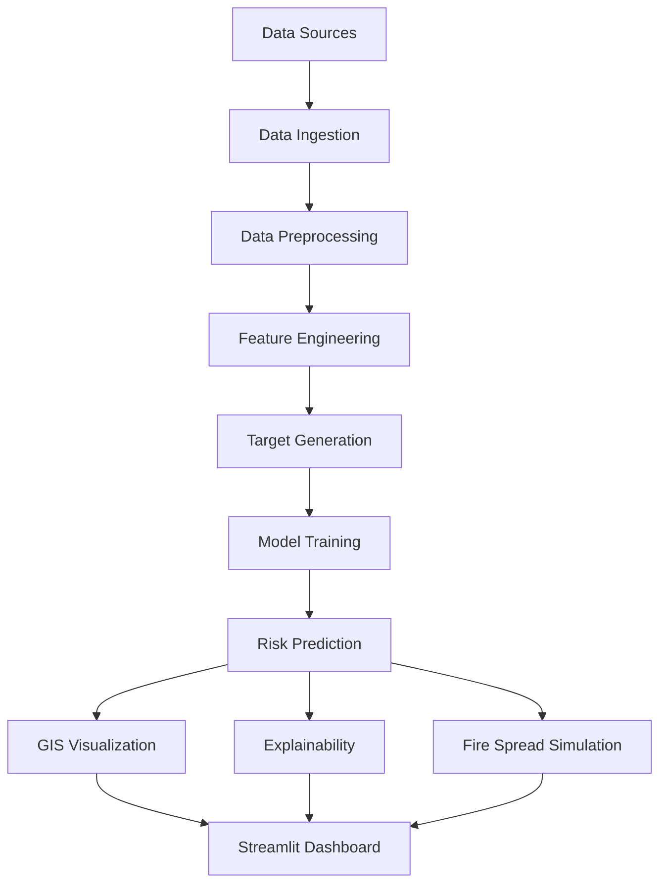
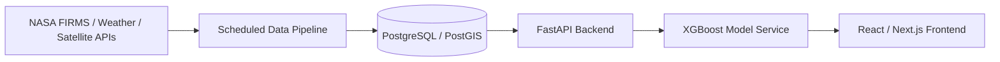

# System Architecture

## Prototype Architecture (implemented in this repository)

### Component Mapping
| Stage | Module |
|---|---|
| Data Sources (demo) | `generate_demo_data.py` |
| Data Ingestion | `data_loader.py` |
| Data Preprocessing | `preprocessing.py` |
| Feature Engineering | `feature_engineering.py` |
| Target Generation | `feature_engineering.generate_target()` |
| Model Training | `train_models.py` |
| Risk Prediction | `evaluate_models.py`, `risk_mapping.build_risk_table()` |
| GIS Visualization | `risk_mapping.py` |
| Explainability | `explainability.py` |
| Fire Spread Simulation | `fire_spread.py` |
| Dashboard | `07_Dashboard/app.py` |

All stages read configuration (paths, study region, thresholds, model
parameters) from a single source of truth: `04_Source_Code/config.py`.

## Future Production Architecture (NOT implemented in Phase-I)

This production architecture would replace the local Streamlit prototype
with a scheduled ETL pipeline, a spatial database, a REST API backend, and
a modern web frontend suitable for multi-user, always-on deployment. It is
documented here as the Phase-II/III target, not built in this capstone
(see `FUTURE_WORK.md`), because the local Streamlit prototype is the
priority within the current project timeline.
