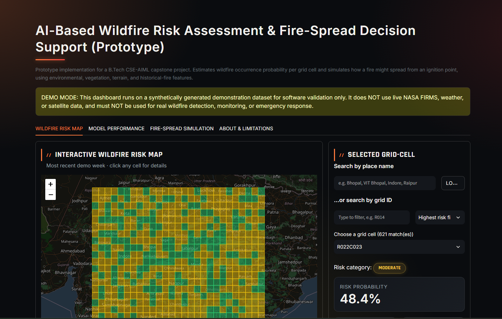
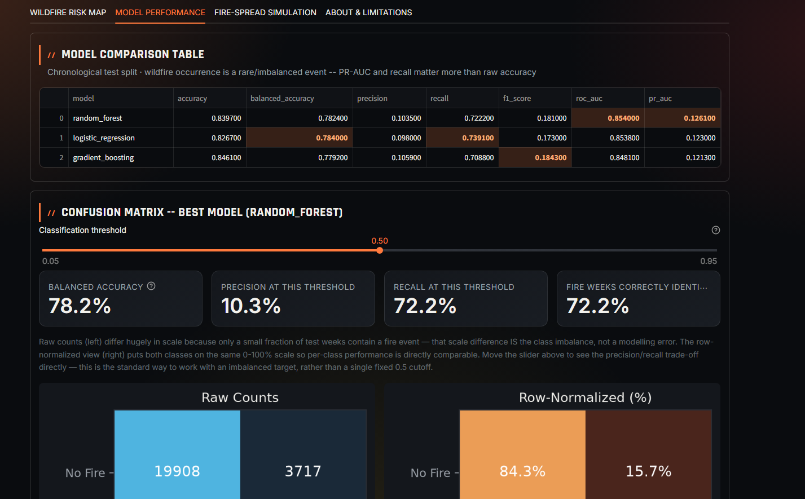
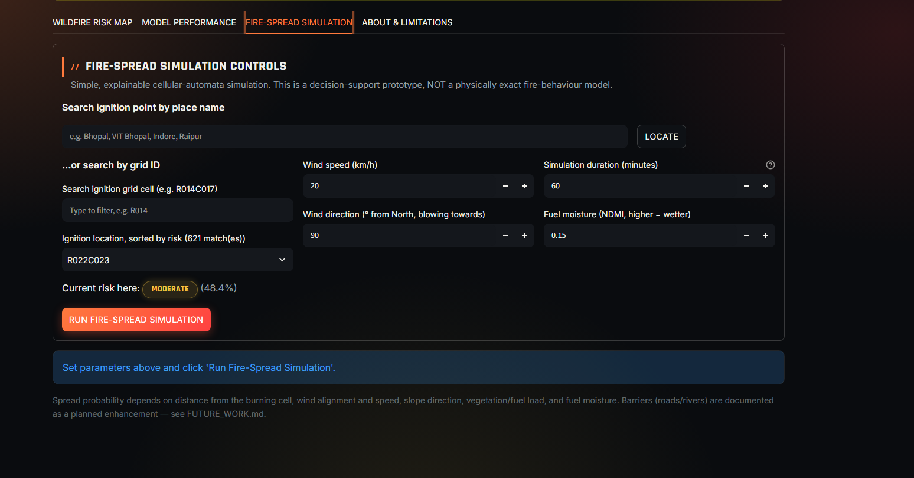
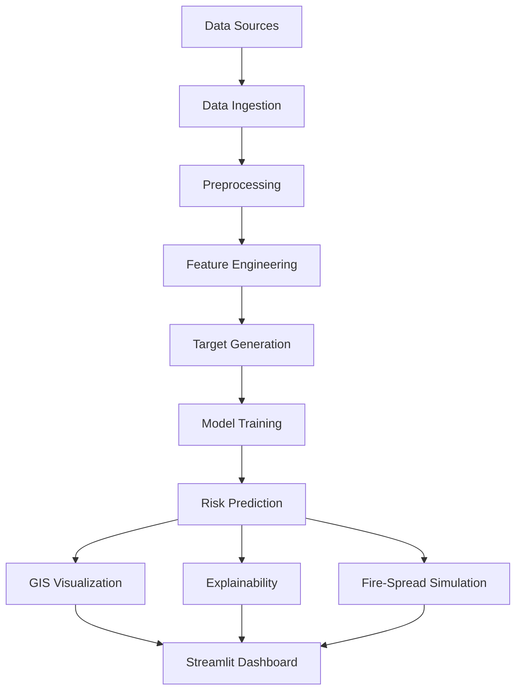

# 🔥 AI-Based Wildfire Risk Assessment & Fire-Spread Decision Support


An end-to-end geospatial machine-learning prototype that estimates **where a wildfire is likely to occur** over the next 7 days and **how a fire might spread** from a chosen ignition point. Default study region: **Madhya Pradesh & Chhattisgarh, India**.

Built as a B.Tech CSE (AI & ML) capstone project, Phase 1.

> ⚠️ **Demo mode.** Phase 1 runs on a **synthetically generated dataset** with a realistic schema and seasonal/spatial patterns, for software validation only. It does **not** use real NASA FIRMS, weather, or satellite data, and must **not** be used for real wildfire detection, monitoring, or emergency response. All metrics below are illustrative.

---

## Screenshots

| Wildfire risk map | Model performance | Fire-spread simulation |
|---|---|---|
|  |  |  |

---

## What it does

1. **Wildfire risk assessment**: given vegetation, terrain, weather and historical-fire features, predict the probability that a grid cell sees a fire in the next 7-day window.
2. **Fire-spread simulation**: given an ignition cell, wind, slope, fuel load and moisture, simulate how fire may spread to neighbouring cells over a chosen time horizon.

## Features

- **Leak-free ML pipeline**: ingestion → cleaning → feature engineering → target generation → training → evaluation → explainability → risk mapping → spread simulation → dashboard
- **Three models compared**: Logistic Regression, Random Forest, Gradient Boosting
- **Chronological train/val/test split** (no random shuffling of time series)
- **Imbalance-aware evaluation**: precision, recall, F1, balanced accuracy, ROC-AUC, PR-AUC, confusion matrix
- **Explainability**: SHAP with automatic fallback to feature, permutation or coefficient importance
- **Interactive Folium risk map** with Low / Moderate / High / Extreme categories
- **Explainable cellular-automata spread model** driven by wind, slope, fuel and moisture
- **Local Streamlit dashboard**: no database, no cloud, no API keys
- **Place-name and grid-ID search** to pick a cell (e.g. Bhopal, Indore, Raipur)
- **One-command demo**: `python run_demo.py`

## Dashboard

The Streamlit app has four tabs:

| Tab | What you get |
|---|---|
| **Wildfire Risk Map** | Colour-coded grid map, click or search any cell for its risk category and probability |
| **Model Performance** | Model comparison table and a confusion matrix with an adjustable classification threshold |
| **Fire-Spread Simulation** | Choose an ignition cell, wind speed/direction, duration and fuel moisture, then run the simulation |
| **About & Limitations** | Scope, assumptions and caveats |

## Architecture



More detail in [`08_Documentation/SYSTEM_ARCHITECTURE.md`](08_Documentation/SYSTEM_ARCHITECTURE.md).

## Quick start

```bash
git clone https://github.com/ashuuXD/Wildfire-Risk-Assessment.git
cd Wildfire-Risk-Assessment

# create environment
python -m venv .venv
# Windows:      .venv\Scripts\activate
# Linux/macOS:  source .venv/bin/activate

pip install -r requirements.txt
```

Conda users can use `conda env create -f environment.yml` instead.

**1. Run the full pipeline** (generates data, trains models, builds maps; takes under a minute, fully offline):

```bash
python run_demo.py
```

**2. Launch the dashboard:**

```bash
streamlit run 07_Dashboard/app.py
```

Open the local URL Streamlit prints, usually `http://localhost:8501`.

> Trained models, processed data and maps are **not stored in the repo**. `run_demo.py` regenerates all of them.

## Example results (synthetic data, illustrative only)

Chronological test split. Wildfire occurrence is a rare event, so PR-AUC and recall matter more than raw accuracy.

| Model | Recall | Precision | F1 | ROC-AUC | PR-AUC |
|---|---|---|---|---|---|
| Random Forest | 0.722 | 0.104 | 0.181 | **0.854** | **0.126** |
| Logistic Regression | 0.739 | 0.098 | 0.173 | 0.854 | 0.123 |
| Gradient Boosting | 0.709 | 0.106 | 0.184 | 0.848 | 0.121 |

Low precision is expected: fire weeks are a small fraction of all weeks, so even a good ranking model produces many false alarms at a fixed 0.5 threshold. The dashboard's threshold slider lets you explore the precision/recall trade-off.

## Project structure

```
Wildfire-Risk-Assessment/
├── 01_Research/        Objectives, problem statement, scope, literature review & matrix
├── 02_Data/            Sample data + data dictionary (full data generated on run)
├── 03_Notebooks/       5 notebooks mirroring the pipeline stages
├── 04_Source_Code/     Python modules (config, data, features, training, evaluation,
│                       explainability, risk mapping, fire spread, visualization)
├── 05_Models/          Training metadata & evaluation (model files generated on run)
├── 06_GIS/             Interactive risk & spread maps (generated on run)
├── 07_Dashboard/       Streamlit app
├── 08_Documentation/   Architecture, methodology, model card, data pipeline,
│                       user guide, future work
├── requirements.txt
├── environment.yml
└── run_demo.py         One-command pipeline runner
```

## Notebooks

| Notebook | Purpose |
|---|---|
| `01_data_exploration` | Explore the dataset |
| `02_feature_engineering` | Build model features |
| `03_model_training` | Train the three classifiers |
| `04_model_evaluation` | Metrics and confusion matrix |
| `05_risk_map_generation` | Generate the interactive risk map |

## Data source plan (Phase 2)

| Category | Planned source |
|---|---|
| Historical fire | [NASA FIRMS](https://firms.modaps.eosdis.nasa.gov/) (MODIS/VIIRS) |
| Weather | [NASA POWER](https://power.larc.nasa.gov/) / IMD |
| Vegetation & satellite | [Google Earth Engine](https://earthengine.google.com/) |
| Terrain | [Copernicus DEM GLO-30](https://registry.opendata.aws/copernicus-dem/) |

Phase 1 uses a synthetic dataset with the same schema (see [`02_Data/README.md`](02_Data/README.md)). Real-data adapters are written and documented in `04_Source_Code/data_loader.py` but **not yet executed**.

## Limitations

- Trained and evaluated only on synthetic demo data
- Risk thresholds and spread parameters are uncalibrated prototype values
- Study area is a rectangular bounding box, not exact administrative boundaries
- The fire-spread model is a simplified cellular automaton, not a physical model like Rothermel or FARSITE
- Feature importance must not be read as causation
- Not validated or suitable for operational or emergency use

Full details: [`01_Research/SCOPE_AND_LIMITATIONS.md`](01_Research/SCOPE_AND_LIMITATIONS.md)

## Roadmap (Phase 2)

- Integrate real NASA FIRMS, weather and satellite data
- Calibrate risk thresholds on real outcomes
- Use exact administrative boundaries
- Barrier-aware spread (roads, rivers)
- Deep-learning extensions
- Production architecture (FastAPI + PostGIS + React)

Full roadmap: [`08_Documentation/FUTURE_WORK.md`](08_Documentation/FUTURE_WORK.md)

## Honesty note

This repository does not claim real experiments, real downloaded datasets or real model scores. Everything is labelled as a prototype on a demonstration dataset. Real-world validation is future work, not a completed step.

## License

MIT. See [`LICENSE`](LICENSE). This is an academic prototype, not an operational safety system.

## Author

**ashuuXD**, B.Tech CSE (AI & ML)